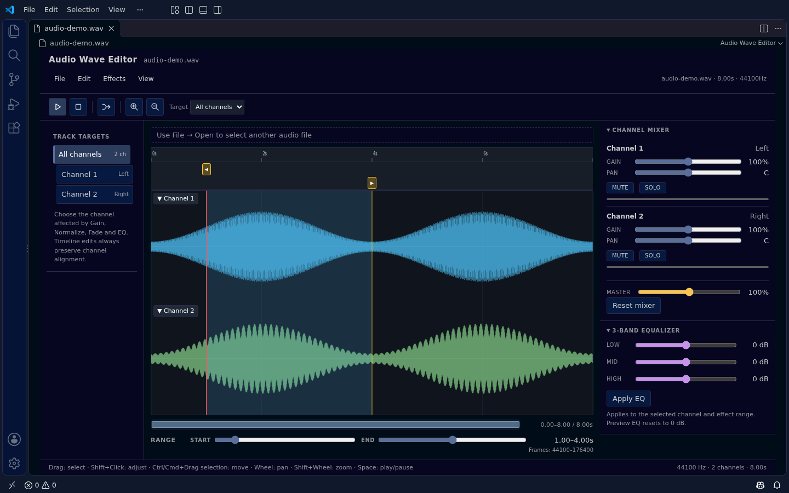
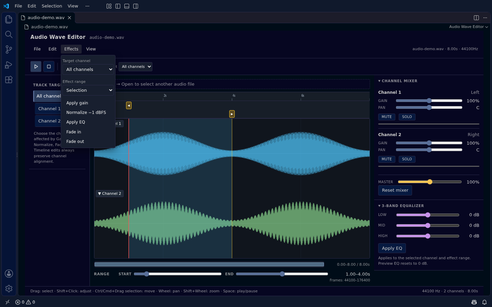

# Audio Wave Editor

VS Code에서 오디오 파형을 확인하고 선택 구간을 편집하는 확장입니다. 채널별 믹싱과 3-band EQ를 미리 듣고, 결과를 PCM16 WAV 또는 MP3로 내보낼 수 있습니다.

## 주요 기능

- **파형과 선택**: 채널별 파형, 공통 시간 룰러, 프레임 단위 선택과 경계 핸들을 제공합니다. 채널 파형은 각각 접을 수 있습니다.
- **재생과 이동**: 선택 구간을 재생·일시정지하고 확대·축소하거나 스크롤할 수 있습니다. 최대 확대의 표시 범위는 0.1초입니다. 그보다 짧은 파일은 전체 길이를 표시합니다.
- **효과와 믹싱**: 채널 Gain/Pan/Mute/Solo와 3-band EQ를 미리 듣습니다. Gain, Normalize, EQ, Fade를 선택 범위에 적용하고 stereo를 mono로 믹싱할 수 있습니다.
- **편집 이력**: Cut/Copy/Paste/Delete와 이펙트 적용을 Undo/Redo합니다. 커스텀 에디터는 VS Code 편집 이력과 백업을 사용합니다.

## 시작하기

1. VS Code에서 오디오 파일을 마우스 오른쪽 버튼으로 클릭하고 **Open With... → Audio Wave Editor**를 선택합니다.
2. 타임라인을 드래그해 구간을 선택하거나 클릭해 재생 위치를 지정합니다. 선택 경계는 룰러 아래 핸들로 조정할 수 있습니다.
3. 툴바에서 재생하고, 필요하면 **Effects** 메뉴에서 대상 채널·범위와 효과를 선택합니다. EQ는 오른쪽 패널에서도 직접 적용할 수 있습니다.
4. 편집된 WAV를 저장하거나 **File** 메뉴에서 WAV·MP3 내보내기를 선택합니다.

Command Palette의 **Audio Wave Editor: Open**으로 독립 창을 열 수도 있습니다. 독립 창은 자체 편집 이력을 사용합니다.

## 파일과 저장

입력 지원 여부는 VS Code Webview의 Web Audio API 디코딩 성공 여부로 결정됩니다. 확장자만으로 지원을 보장하지 않습니다. 일반 저장은 WAV 원본에 편집된 샘플을 PCM16으로 기록합니다. MP3 등 다른 형식으로 연 파일은 **Save As**에서 `.wav`를 선택하세요.

**Export WAV**와 **Export MP3**는 현재 미리 듣기 믹서·EQ 설정까지 반영합니다. **Export next WAV version**과 **Export next MP3 version**은 원본 옆에 `파일명_v001.wav` 또는 `파일명_v001.mp3`처럼 번호를 붙입니다. 기존 파일을 덮어쓰지 않으며 형식별로 가장 큰 번호의 다음 번호를 사용합니다. 독립 창에서 원본 위치를 알 수 없는 경우에는 저장 대화상자를 사용합니다.

MP3는 손실 압축이며 mono/stereo만 지원합니다. 32/44.1/48 kHz는 192 kbps, 16/22.05/24 kHz는 128 kbps, 8/11.025/12 kHz는 64 kbps로 인코딩합니다. 지원되지 않는 샘플레이트나 3채널 이상은 내보내지 않습니다. 인코더 지연·패딩으로 재생 길이에 작은 차이가 생길 수 있습니다. 인코더 라이선스는 [서드파티 안내](THIRD_PARTY_NOTICES.md)를 참고하세요.

## 주요 조작

| 조작 | 동작 |
| --- | --- |
| Space | 재생 / 일시정지 |
| 드래그 | 구간 선택 |
| Shift+클릭 또는 드래그 | 가까운 선택 경계 조정 |
| Ctrl/Cmd+드래그 | 선택 영역 전체 이동 |
| Shift/Ctrl+휠 | 커서 위치 기준 확대·축소 |
| Ctrl/Cmd+Z / Ctrl/Cmd+Shift+Z | Undo / Redo |

## 개발과 검증

`npm install` 후 `vscode-audio.code-workspace`를 VS Code에서 열고 `F5`를 누르면 Extension Development Host가 실행됩니다. 별도의 `vscode-markdown` 워크스페이스에서 F5를 실행하지 마세요.

- `npm run check`: JavaScript 구문 검사
- `npm run test:unit`: 오디오 상태·내보내기 단위 테스트
- `npm run test:e2e`: Extension Host 기능 테스트
- `npm run test:e2e:screenshots`: 테스트 오디오로 이 README의 화면 캡처 재생성
- `npm run package`: VSIX 패키지 생성

E2E는 `.vscode-test` 아래의 테스트 전용 사용자 데이터와 확장 디렉터리를 사용합니다. 생성된 VSIX는 **Extensions → … → Install from VSIX…**에서 설치합니다. 패키지에는 작업 디렉터리의 현재 코드가 포함되므로 커밋하지 않은 변경도 반영됩니다.

확장 식별자는 `devchan64.vscode-audio-wave-editor`입니다. Marketplace 게시 전 이름과 표시 이름의 사용 가능 여부를 확인하세요.

## 라이선스와 배포

MP3 인코더의 고지와 라이선스 원문은 [서드파티 안내](THIRD_PARTY_NOTICES.md)를 참고하세요. 프로젝트 자체 라이선스는 아직 정해지지 않았으며, 인코더 소스 제공과 교체 가능성에도 배포 전 확인이 남아 있습니다. 근거와 남은 작업은 [라이선스 검토](docs/license-review.md)에 정리했습니다.

## 설계 문서

[기능 범위](docs/design.md) · [화면 구성](docs/ui-design.md) · [구현 계획](docs/implementation-plan.md) · [상세 설계](docs/detailed-design.md) · [기능 시나리오](docs/feature-scenarios.md) · [테스트 체크리스트](docs/tc-checklist.md)
