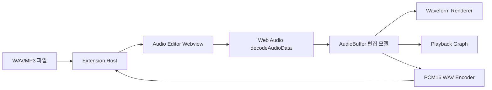

# Audio Wave Editor 설계

## 1. 목표

VS Code 안에서 음성·음악 파일의 기본 편집을 빠르게 수행한다. 전문 DAW의 멀티트랙 편집을 목표로 하지 않으며, 파일을 열고 확인하고 간단히 보정한 뒤 WAV로 내보내는 흐름을 우선한다.

## 2. 범위

### 지원

- WAV, MP3 디코드
- 전체 파형 및 선택 구간 표시
- 선택 구간 재생
- 채널별 게인 조절
- Low/Mid/High EQ
- Peak Normalize
- stereo-to-mono 믹싱
- PCM16 WAV 내보내기

### 후속 범위

- 비파괴 편집 히스토리와 Undo/Redo
- 멀티트랙 타임라인과 클립 이동
- MP3 인코딩 내보내기
- 페이드, 트림, 크로스페이드
- 스펙트로그램과 실시간 미터

## 3. 아키텍처



확장 호스트는 파일 선택과 저장을 담당하고, 오디오 디코드·편집·재생은 Webview에서 수행한다. 저장 시 Webview가 PCM WAV 바이트를 Base64 메시지로 전달한다.

## 4. 상태와 메시지

```text
empty -> loading -> ready -> playing
ready -> processing -> ready
ready -> exporting -> ready
loading/processing/exporting -> error
```

메시지는 `open`, `save` 등 명시적인 타입을 사용한다. 저장 응답은 성공 또는 사용자에게 다음 행동을 안내하는 오류여야 한다.

## 5. 오디오 불변식

- 모든 샘플은 [-1, 1] 범위로 clamp한다.
- Normalize peak는 1.0을 초과하지 않는다.
- 출력 WAV의 PCM은 little-endian signed 16-bit다.
- 채널별 게인은 0 이상 2 이하의 선형 배율로 표현한다.
- 선택 구간의 시작은 끝보다 크지 않아야 한다.
