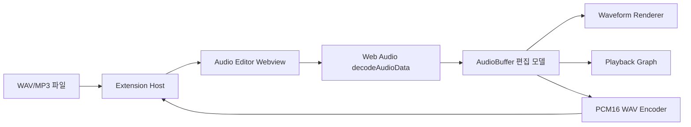

# Audio Wave Editor 설계

## 1. 목표

VS Code 안에서 음성·음악 파일의 기본 편집을 빠르게 수행한다. 전문 DAW의 멀티트랙 편집을 목표로 하지 않으며, 파일을 열고 확인하고 간단히 보정한 뒤 WAV로 내보내는 흐름을 우선한다.

## 2. 범위

### 지원

- Web Audio API가 실제로 디코드할 수 있는 오디오 포맷
- 전체 파형 및 선택 구간 표시
- 선택 구간 재생
- 채널별 파형 접기와 펼치기 (표시만 변경)
- 파형과 분리된 시간 룰러, 표시 구간 스크롤바와 접을 수 있는 믹서·EQ 패널과 이펙트 적용 메뉴
- 커스텀 에디터의 VS Code Undo/Redo·수정 상태·백업과 독립 창의 자체 Undo/Redo
- 채널별 게인 조절
- 채널별 실시간 peak meter
- Low/Mid/High EQ 미리 듣기와 선택 구간·대상 채널에 직접 적용
- Peak Normalize 및 선택 구간 Fade in/out
- stereo-to-mono 믹싱
- PCM16 WAV 및 mono/stereo MP3 내보내기
- 원본 옆 숫자 버전 WAV/MP3 내보내기

입력 포맷의 지원 여부는 확장자가 아니라 VS Code Webview의 `decodeAudioData` 성공 여부로만 판정한다. 디코드에 실패한 파일은 지원하지 않는다.

### 후속 범위

- 비파괴 편집 모델과 세션 간 영속 편집 이력
- 멀티트랙 타임라인과 클립 이동
- 트림과 크로스페이드
- 스펙트로그램

## 3. 아키텍처



확장 호스트는 파일 선택·저장과 MP3 인코딩 Worker를 담당하고, 오디오 디코드·편집·재생은 Webview에서 수행한다. 내보내기는 Webview에서 처리된 PCM WAV를 호스트에 전달하며 MP3는 이를 Worker에서 인코딩한다. 커스텀 문서의 저장·백업은 호스트가 Webview에서 편집 상태를 받아 기록한다.

## 4. 상태와 메시지

```text
empty -> loading -> ready -> playing
ready -> processing -> ready
ready -> exporting -> ready
loading/processing/exporting -> error
```

메시지는 `open`, `save` 등 명시적인 타입을 사용한다. 저장 응답은 성공 또는 사용자에게 다음 행동을 안내하는 오류여야 한다.

## 5. 오디오 불변식

- 효과 적용과 WAV 출력은 결과 샘플을 [-1, 1] 범위로 clamp한다. 디코드된 원본 샘플은 편집 전 임의로 변경하지 않는다.
- Normalize peak는 1.0을 초과하지 않는다.
- 출력 WAV의 PCM은 little-endian signed 16-bit다.
- 채널별 게인은 0 이상 2 이하의 선형 배율로 표현한다.
- 선택 구간의 시작은 끝보다 크지 않아야 한다.
