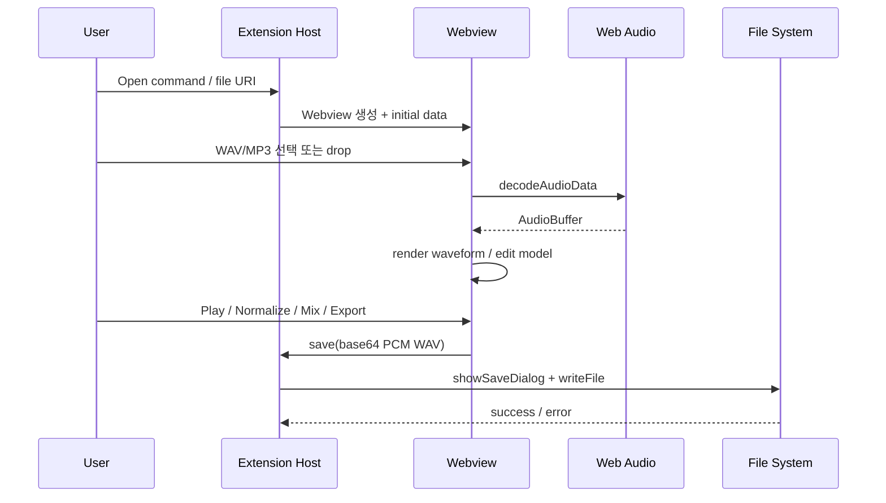

# Audio Wave Editor 상세 설계

## 1. 설계 목표와 비목표

### 목표

- 원본 파일을 안전하게 열고, 편집 결과를 예측 가능한 PCM WAV로 저장한다.
- 파형·재생·처리 결과가 같은 오디오 상태를 바라보도록 한다.
- Webview가 실패해도 저장 경로와 사용자 피드백은 확장 호스트가 책임진다.
- 기능을 단위 테스트 가능한 오디오 연산으로 분리한다.

### 비목표

- 전문 DAW 수준의 실시간 멀티트랙 믹서
- 무손실 MP3 재인코딩
- 대용량 파일 스트리밍 편집
- 자동 저장 또는 원본 파일 덮어쓰기

## 1.1 입력 포맷 정책

포맷 목록을 하드코딩해 지원을 보장하지 않는다. 파일 선택기는 `audio/*`를 허용할 수 있지만, 최종 판정은 항상 VS Code Webview의 `decodeAudioData` 성공 여부다. 디코드 실패는 `E_DECODE`로 처리하고 기존 문서를 유지한다.

## 2. 실행 경계



확장 호스트는 파일 시스템과 VS Code API를 담당하고, Webview는 오디오 데이터와 UI를 담당한다. 둘 사이에는 파일 경로 대신 명시된 메시지만 전달한다.

## 3. 데이터 모델

```ts
type AudioDocument = {
  name: string;
  sampleRate: number;
  channels: number;
  length: number;
  duration: number;
  buffer: AudioBuffer;
  revision: number;
};

type EditorState = {
  document: AudioDocument | undefined;
  selection: { start: number; end: number };
  channelGain: number[]; // linear, 0..2
  eq: { low: number; mid: number; high: number }; // dB, -12..12
  transport: 'stopped' | 'playing' | 'processing' | 'exporting';
  error?: { code: string; message: string };
};
```

`AudioBuffer`는 immutable source로 취급하고, 처리 명령은 새 `AudioBuffer`를 반환하는 방향을 우선한다. 현재 MVP의 Normalize/Mix는 직접 변경하지만, `AudioOperations` 분리 시 copy-on-write로 전환한다.

## 4. 오디오 처리 계약

모든 연산은 입력을 검증하고, 샘플 중간값과 최종값을 `[-1, 1]`로 clamp하며, 처리 결과의 `revision`을 증가시킨다.

### 4.1 채널 게인

`out[c][i] = clamp(input[c][i] * gain[c])`

- `gain[c]` 범위: 0.0–2.0
- 채널 수보다 많은 게인 값은 무시한다.
- 채널 수가 변경되면 게인 배열을 1.0으로 재생성한다.

### 4.2 EQ

미리 듣기는 실시간 `AudioContext` 그래프에서, WAV 내보내기는 `OfflineAudioContext`에서 `BiquadFilterNode`를 직렬로 적용한다. Low는 250 Hz lowshelf, Mid는 1 kHz peaking(Q=1), High는 4 kHz highshelf이며 각 주파수는 Nyquist의 95% 이하로 제한한다. 각 밴드의 게인은 -12–12 dB다. 채널·마스터 게인과 pan을 먼저 적용하고 EQ 렌더링 후 출력을 [-1, 1]로 제한한다. `Apply EQ`는 선택한 프레임 구간과 대상 채널만 별도의 오프라인 필터로 처리하고 결과를 원본 버퍼에 적용한다. 경계에서 필터 상태는 초기화되며 출력은 [-1, 1]로 제한한다. 적용 후 미리 듣기 EQ는 0 dB로 초기화하고 이력에서 Undo/Redo할 수 있다.

```ts
type EqBand = {
  type: 'lowshelf' | 'peaking' | 'highshelf';
  frequency: number;
  q: number;
  gainDb: number;
};
```

### 4.3 Normalize

```text
peak = max(abs(sample)) for the selected channels and frames
target = 10 ^ (-1 / 20)  // -1 dBFS
scale = peak > 0 ? target / peak : 1
output = clamp(input * scale, -1, 1)
```

대상 구간이 무음이면 오디오를 변경하거나 편집 이력을 만들지 않고 상태를 표시한다. Normalize는 선택 채널과 Selection/Entire document 범위에 적용한다.

### 4.4 Stereo-to-mono 믹싱

`mono[i] = clamp(sum(channel[c][i]) / channelCount)`

믹싱 후 `channels = 1`, gain 배열은 `[1]`로 초기화한다.

### 4.5 PCM16 WAV 인코딩

```text
RIFF header: 44 bytes
audioFormat = 1
numChannels = buffer.numberOfChannels
sampleRate = buffer.sampleRate
bitsPerSample = 16
blockAlign = numChannels * 2
byteRate = sampleRate * blockAlign
dataSize = frameCount * blockAlign
```

interleaved 순서로 채널을 기록하고, 음수는 `value * 32768`, 양수는 `value * 32767`을 사용한다. 헤더 크기가 32-bit unsigned 범위를 넘으면 저장을 거부한다.

## 5. 파형 렌더링

캔버스 폭을 `W`, 샘플 수를 `N`이라 할 때 `bucket = ceil(N / W)`로 정한다. 각 x 좌표에서 bucket 내 최소값과 최대값을 구해 envelope를 그린다.

- 디코드된 모든 채널을 같은 시간축에 표시한다.
- 화면 폭 기준으로 downsample하여 긴 파일도 렌더링한다.
- 파일·뷰포트·대상 채널·접기 상태나 샘플이 바뀌면 정적 파형을 다시 그린다. 선택과 재생 헤드는 캐시된 파형 위에 갱신한다.

## 5.1 아날로그 그래프 타임라인

타임라인은 편집 위치를 결정하는 기준 좌표계다. 파형 차트 위에 별도 룰러를 두며, 파형 캔버스와 시간 눈금은 동일한 변환을 공유한다.

```text
viewportStart = visible start in seconds
viewportEnd   = visible end in seconds
pixelsPerSec  = canvasWidth / (viewportEnd - viewportStart)
x = (time - viewportStart) * pixelsPerSec
```

- 시간 눈금은 표시 범위에 따라 1/2/5 계열 간격을 사용한다. 큰 눈금·작은 눈금의 구분은 후속 항목이다.
- 향후 0 dB 기준선과 ±6/±12 dB 보조선을 표시한다.
- stereo는 채널별 lane, mono는 하나의 lane을 사용한다.
- 각 채널의 접기 버튼은 해당 파형 lane을 축소하며, 공통 시간축과 재생·편집 대상은 유지한다. 파일을 새로 열거나 mono로 믹싱하면 접기 상태를 초기화한다.
- 선택 영역은 반투명하게 칠하며 양 끝의 핸들을 드래그하거나 포커스 후 방향키로 프레임 단위로 이동한다. 경계는 서로 넘어가지 않으며 핸들 조작 시 최소 한 프레임을 유지한다. 좁은 선택에서는 핸들을 세로로 분리하고 화면 경계에서 잘리지 않게 한다.
- 재생 헤드는 수직선으로 표시하며, 현재 시간 라벨은 향후 제공한다.

파형 아래의 스크롤바는 전체 길이 대비 viewport를 표시하며 드래그, 트랙 클릭, 키보드 이동을 지원한다. 최소 손잡이 크기가 적용되는 확대 수준에서는 손잡이 길이가 실제 비율보다 크다. 줌·이동과 오디오 길이 변경 시 표시를 동기화한다. 캔버스 클릭은 헤드 이동, 드래그는 선택, Shift/Ctrl+휠은 커서 중심 줌, 휠은 가로 스크롤, Space는 재생/일시정지다. 경계에 도달하지 않은 경우 줌 시 커서 아래 시간을 유지한다.

현재 MVP는 별도 룰러에 시간 라벨과 1/2/5 계열 눈금을 그리고, 파형 캔버스에는 시간 격자·채널 파형·선택 영역·재생 헤드를 그린다. 최대 확대의 표시 범위는 `min(0.1초, 파일 길이)`이며 룰러와 파형은 같은 시간 변환을 사용한다. 스크롤바 손잡이는 최소 16px을 유지하고 이동 범위를 전체 파일에 대응시킨다. 정적 파형과 격자는 캐시해 재생 헤드 이동 시 재계산하지 않으며, 줌·이동·접기·대상 변경 또는 오디오 편집 시 다시 그린다. 세부 눈금과 다중 해상도 envelope 캐시는 향후 구현 목표다.

## 6. 재생 그래프

재생은 원본 `AudioBufferSourceNode`를 채널 분리·gain·합성, 3-band EQ, clipping 제한 노드에 연결한다. 믹서와 EQ 조작은 재생 중 그래프에 반영되고 미터는 실시간 샘플을 표시한다. Pause는 현재 위치를 저장하고 다음 source를 그 위치에서 시작하며 Stop은 선택 시작점으로 돌아간다. Pause·Stop·종료 시 source와 연결 노드를 해제한다.

WAV 내보내기는 별도로 `OfflineAudioContext`에서 동일한 고정 파라미터를 렌더링한다. 재생 그래프와 내보내기의 mono/stereo, 44.1/48 kHz, 무음과 clipping 경계 결과를 비교한다. 선택 중간에서 재생하거나 재개할 때 EQ 필터 상태는 해당 위치에서 새로 시작한다.

## 7. 메시지 계약

```ts
type ExtensionToWebview =
  | { type: 'documentLoaded'; name: string; duration: number; sampleRate: number; channels: number }
  | { type: 'saveResult'; ok: true; path: string }
  | { type: 'saveResult'; ok: false; code: string; message: string };

type WebviewToExtension =
  | { type: 'save'; data: string; suggestedName?: string };
```

알 수 없는 `type`은 거부한다. Base64 데이터와 파일명은 타입·크기를 검증하고, Webview가 전달한 경로로 직접 쓰지 않고 항상 VS Code 저장 대화상자를 거친다.

## 8. 오류 코드

| 코드 | 조건 | 사용자 안내 |
| --- | --- | --- |
| `E_NO_DOCUMENT` | 파일 없이 편집 명령 실행 | 먼저 WAV/MP3 파일을 연다. |
| `E_DECODE` | Web Audio 디코드 실패 | 다른 파일 또는 지원 코덱을 사용한다. |
| `E_INVALID_SELECTION` | start가 end보다 큼 | 선택 구간을 다시 지정한다. |
| `E_WAV_TOO_LARGE` | WAV 32-bit 크기 초과 | 파일을 구간별로 나누어 저장한다. |
| `E_SAVE_CANCELLED` | 저장 대화상자 취소 | 다른 경로를 선택해 다시 저장한다. |
| `E_SAVE_FAILED` | 파일 쓰기 실패 | 권한과 디스크 공간을 확인한다. |

## 9. 구현 순서

1. `src/shared/messages.ts`와 상태 모델 정의
2. `AudioOperations` 단위 테스트와 clamp/normalize/mix 구현
3. `WavEncoder` 단위 테스트와 RIFF 검증
4. `WaveformRenderer`와 `PlaybackController` 분리
5. Extension Host 저장 메시지 검증·오류 응답 추가
6. trim과 고급 EQ 고도화

## 커스텀 문서 이력과 저장

Fade, Normalize, Gain 및 EQ 적용은 변경 대상 채널과 프레임 범위의 편집 전후 `Float32Array`와 선택·채널 설정을 이력에 저장한다. 커스텀 에디터는 이 구간을 `CustomDocumentEditEvent`에 연결하고 Webview와 확장 호스트가 typed array로 주고받는다. VS Code가 Undo/Redo를 호출하면 Webview에 해당 구간을 복원하고 응답을 기다린다. 독립 Webview도 동일한 구간 이력을 자체 스택에 보관한다. Cut·Delete는 삭제된 구간, Paste는 삽입된 구간만 보관하고 위치와 프레임 수로 Undo/Redo한다. mono 믹싱은 원본 채널만 저장하며 Redo 때 동일한 평균 연산으로 mono를 다시 만든다.

mono 믹싱은 교체되는 원본 버퍼의 채널 배열을 읽기 전용 이력으로 보존해 Webview에서 별도 원본 복사본을 만들지 않는다. 이후 편집은 새 mono 버퍼에 적용하며, Undo는 보존된 채널을 새 버퍼로 복원한다. 커스텀 에디터의 Webview와 확장 호스트 사이 메시지 전달에 따른 복사는 여전히 발생한다.

일반 저장은 WAV 원본에만 PCM16으로 기록한다. 다른 형식의 원본은 Save As에서 WAV를 선택해야 한다. 저장은 편집된 오디오 버퍼를 기록하며 미리 듣기용 믹서·EQ는 적용하지 않는다. 이를 포함한 출력은 Export WAV를 사용한다. 백업은 Float32 샘플과 편집 상태를 보존하며 복구 시 새 Webview에 적용한다. 되돌리기는 원본 파일을 다시 디코드한다. 길이가 바뀌는 편집은 실행·복원할 때 새 전체 버퍼를 생성한다. mono 믹싱은 원본 전체 채널을 이력에 보관하고 저장·백업도 전체 버퍼를 전달하므로 긴 파일에서 메모리와 처리 시간이 많이 필요하다. 이력 메모리 예산과 디스크 보관은 아직 구현하지 않았다.

### 처리 중 입력 잠금

오디오 디코드, 편집·복원, Undo/Redo 및 WAV 준비는 Webview 내부에 진행 상태를 표시하고 편집 영역을 비활성화한다. 중첩 작업은 참조 수로 관리하며 성공 또는 실패 시 잠금을 해제한다. VS Code 이력 요청은 완료 응답이나 시간 초과 시 잠금을 해제한다. 이 잠금은 Webview 내부 입력에 적용된다.
