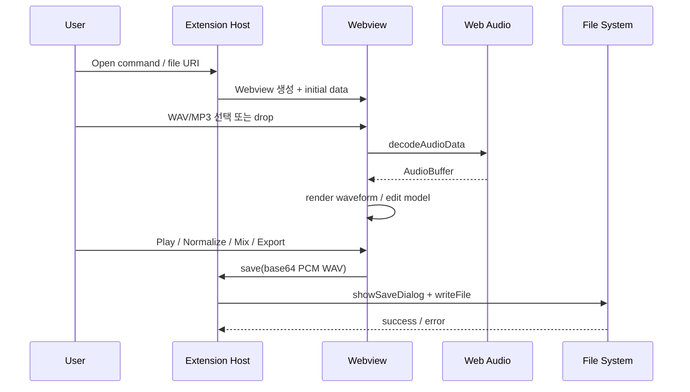

# Audio Wave Editor 상세 설계

## 1. 설계 목표와 비목표

### 목표

- 원본 파일을 안전하게 열고, 편집 결과를 예측 가능한 PCM WAV로 저장한다.
- 파형·재생·처리 결과가 같은 오디오 상태를 바라보도록 한다.
- Webview가 실패해도 저장 경로와 사용자 피드백은 확장 호스트가 책임진다.
- 기능을 단위 테스트 가능한 오디오 연산으로 분리한다.

### 비목표

- 전문 DAW 수준의 실시간 멀티트랙 믹서
- 무손실 MP3 재인코딩
- 대용량 파일 스트리밍 편집
- 자동 저장 또는 원본 파일 덮어쓰기

## 1.1 입력 포맷 정책

포맷 목록을 하드코딩해 지원을 보장하지 않는다. 파일 선택기는 `audio/*`를 허용할 수 있지만, 최종 판정은 항상 VS Code Webview의 `decodeAudioData` 성공 여부다. 디코드 실패는 `E_DECODE`로 처리하고 기존 문서를 유지한다.

## 2. 실행 경계



확장 호스트는 파일 시스템과 VS Code API를 담당하고, Webview는 오디오 데이터와 UI를 담당한다. 둘 사이에는 파일 경로 대신 명시된 메시지만 전달한다.

## 3. 데이터 모델

```ts
type AudioDocument = {
  name: string;
  sampleRate: number;
  channels: number;
  length: number;
  duration: number;
  buffer: AudioBuffer;
  revision: number;
};

type EditorState = {
  document: AudioDocument | undefined;
  selection: { start: number; end: number };
  channelGain: number[]; // linear, 0..2
  eq: { low: number; mid: number; high: number }; // dB, -12..12
  transport: 'stopped' | 'playing' | 'processing' | 'exporting';
  error?: { code: string; message: string };
};
```

`AudioBuffer`는 immutable source로 취급하고, 처리 명령은 새 `AudioBuffer`를 반환하는 방향을 우선한다. 현재 MVP의 Normalize/Mix는 직접 변경하지만, `AudioOperations` 분리 시 copy-on-write로 전환한다.

## 4. 오디오 처리 계약

모든 연산은 입력을 검증하고, 샘플 중간값과 최종값을 `[-1, 1]`로 clamp하며, 처리 결과의 `revision`을 증가시킨다.

### 4.1 채널 게인

`out[c][i] = clamp(input[c][i] * gain[c])`

- `gain[c]` 범위: 0.0–2.0
- 채널 수보다 많은 게인 값은 무시한다.
- 채널 수가 변경되면 게인 배열을 1.0으로 재생성한다.

### 4.2 EQ

MVP에서는 세 밴드 값을 기본 보정 계수로 사용한다. 정밀한 EQ가 필요해지면 `BiquadFilterNode`와 `OfflineAudioContext`를 도입한다.

```ts
type EqBand = {
  type: 'lowshelf' | 'peaking' | 'highshelf';
  frequency: number;
  q: number;
  gainDb: number;
};
```

### 4.3 Normalize

```text
peak = max(abs(sample)) for every channel and frame
scale = peak > 0 ? min(1 / peak, 1) : 1
output = input * scale
```

무음 파일은 변경하지 않는다. Normalize는 현재 전체 버퍼에 적용한다.

### 4.4 Stereo-to-mono 믹싱

`mono[i] = clamp(sum(channel[c][i]) / channelCount)`

믹싱 후 `channels = 1`, gain 배열은 `[1]`로 초기화한다.

### 4.5 PCM16 WAV 인코딩

```text
RIFF header: 44 bytes
audioFormat = 1
numChannels = buffer.numberOfChannels
sampleRate = buffer.sampleRate
bitsPerSample = 16
blockAlign = numChannels * 2
byteRate = sampleRate * blockAlign
dataSize = frameCount * blockAlign
```

interleaved 순서로 채널을 기록하고, 음수는 `value * 32768`, 양수는 `value * 32767`을 사용한다. 헤더 크기가 32-bit unsigned 범위를 넘으면 저장을 거부한다.

## 5. 파형 렌더링

캔버스 폭을 `W`, 샘플 수를 `N`이라 할 때 `bucket = ceil(N / W)`로 정한다. 각 x 좌표에서 bucket 내 최소값과 최대값을 구해 envelope를 그린다.

- 첫 채널을 기본 표시 채널로 사용한다.
- 화면 폭 기준으로 downsample하여 긴 파일도 렌더링한다.
- 파일·뷰포트·선택 변경 시에만 다시 그린다.

## 5.1 아날로그 그래프 타임라인

타임라인은 편집 위치를 결정하는 기준 좌표계다. 파형 캔버스와 시간 눈금은 동일한 변환을 공유한다.

```text
viewportStart = visible start in seconds
viewportEnd   = visible end in seconds
pixelsPerSec  = canvasWidth / (viewportEnd - viewportStart)
x = (time - viewportStart) * pixelsPerSec
```

- 시간 눈금은 1/2/5 계열 간격을 사용한다: `0.1, 0.2, 0.5, 1, 2, 5초`.
- 큰 눈금에는 시간 라벨, 작은 눈금에는 선만 표시한다.
- 0 dB 기준선은 중앙에 굵게 그리고 ±6/±12 dB 보조선을 표시한다.
- stereo는 채널별 lane, mono는 하나의 lane을 사용한다.
- 선택 영역은 반투명하게 칠하고 양 끝에 draggable handle을 둔다.
- 재생 헤드는 수직선과 현재 시간 라벨로 표시한다.

상호작용은 캔버스 클릭으로 헤드 이동, 드래그로 선택, Shift+휠로 커서 중심 줌, 휠로 가로 스크롤, Space로 재생/정지를 제공한다. 줌 시 커서 아래 시간은 고정한다.

렌더링 순서는 배경·dB 기준선 → 채널별 envelope → 선택 영역 → 시간 눈금 → 재생 헤드·핸들이다. envelope는 캐시하며 줌 배율이 바뀔 때 필요한 해상도만 다시 계산한다.

## 6. 재생 그래프

현재 MVP는 처리된 `AudioBuffer`를 `AudioBufferSourceNode`로 재생한다. 재생할 때마다 source를 새로 만들고 Stop 또는 종료 시 참조를 제거한다.

후속 구조는 `AudioBufferSource → Channel Gain → EQ → Master Gain → Destination`이다. 최종 내보내기는 동일 파라미터를 `OfflineAudioContext`에 적용한다.

## 7. 메시지 계약

```ts
type ExtensionToWebview =
  | { type: 'documentLoaded'; name: string; duration: number; sampleRate: number; channels: number }
  | { type: 'saveResult'; ok: true; path: string }
  | { type: 'saveResult'; ok: false; code: string; message: string };

type WebviewToExtension =
  | { type: 'save'; data: string; suggestedName?: string };
```

알 수 없는 `type`은 거부한다. Base64 데이터와 파일명은 타입·크기를 검증하고, Webview가 전달한 경로로 직접 쓰지 않고 항상 VS Code 저장 대화상자를 거친다.

## 8. 오류 코드

| 코드 | 조건 | 사용자 안내 |
| --- | --- | --- |
| `E_NO_DOCUMENT` | 파일 없이 편집 명령 실행 | 먼저 WAV/MP3 파일을 연다. |
| `E_DECODE` | Web Audio 디코드 실패 | 다른 파일 또는 지원 코덱을 사용한다. |
| `E_INVALID_SELECTION` | start가 end보다 큼 | 선택 구간을 다시 지정한다. |
| `E_WAV_TOO_LARGE` | WAV 32-bit 크기 초과 | 파일을 구간별로 나누어 저장한다. |
| `E_SAVE_CANCELLED` | 저장 대화상자 취소 | 다른 경로를 선택해 다시 저장한다. |
| `E_SAVE_FAILED` | 파일 쓰기 실패 | 권한과 디스크 공간을 확인한다. |

## 9. 구현 순서

1. `src/shared/messages.ts`와 상태 모델 정의
2. `AudioOperations` 단위 테스트와 clamp/normalize/mix 구현
3. `WavEncoder` 단위 테스트와 RIFF 검증
4. `WaveformRenderer`와 `PlaybackController` 분리
5. Extension Host 저장 메시지 검증·오류 응답 추가
6. trim/fade/undo와 OfflineAudioContext 기반 EQ 고도화
